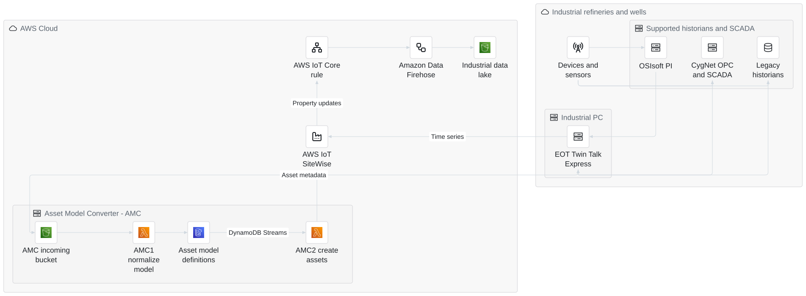
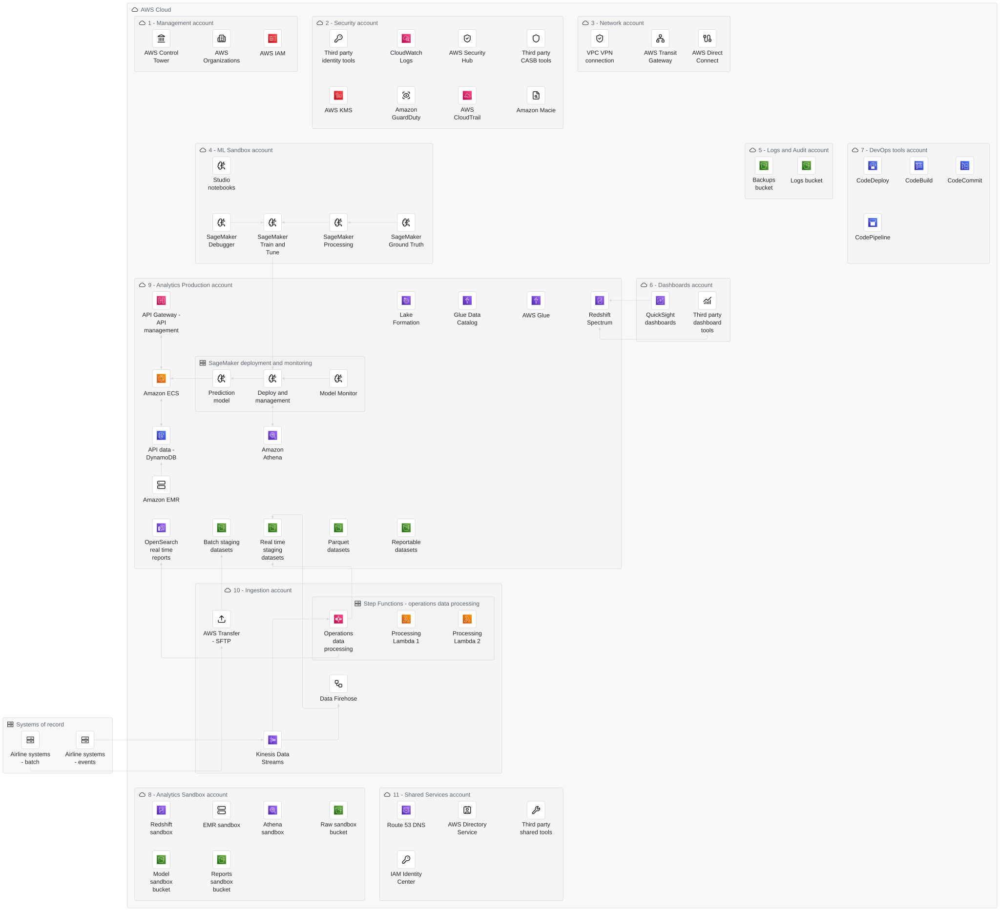
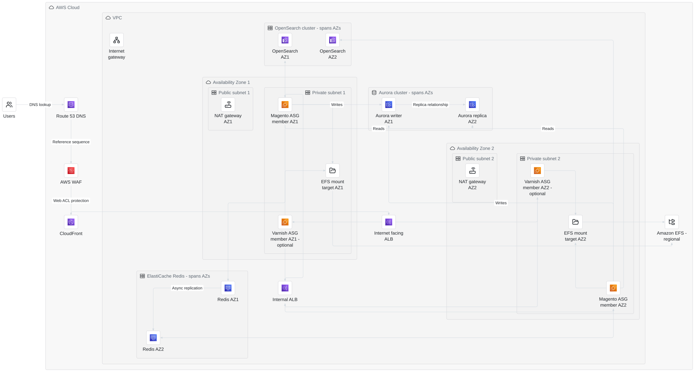
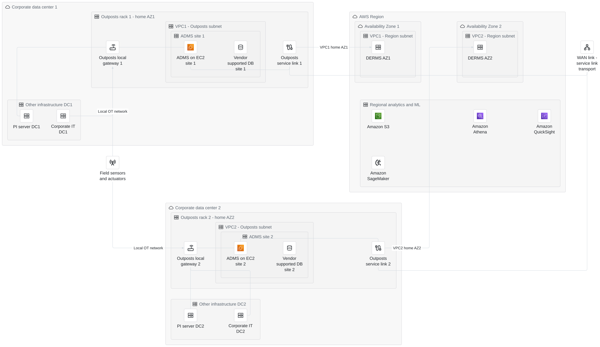

# Four AWS reference architectures, reconstructed in Mermaid

These are source-backed reconstructions of four **published AWS reference architectures**, not invented customer deployments. Both the documentation walkthrough and the actual source image were inspected. They are not AWS-authored diagrams, pixel-identical reproductions, deployment templates, or proof of a running system.

The Mermaid sources retain service identities and important boundaries. Where the original uses overlapping fleet, AZ, VPC or physical-site outlines that Mermaid cannot express with one parent per element, the adaptation is documented below. **The account-security reconstruction intentionally omits several ambiguous shared-bus connections; it is not edge-for-edge complete.**

Sources retrieved **2026-10-25**. [`references.json`](references.json) records publication dates, source/image URLs, hashes of the inspected upstream files, preserved features and adaptations. Original AWS raster diagrams are linked, not redistributed here. Source publications date from 2020–2022; these examples do not claim that every historical service choice is current deployment guidance.

## Open the results

| Reconstruction | Services | SVG | PNG | Source | Evidence |
| --- | ---: | --- | --- | --- | --- |
| Industrial machine connectivity | 13 | [Open](rendered/industrial-machine-connectivity-eot.svg) | [Open](rendered/industrial-machine-connectivity-eot.png) | [Mermaid](sources/industrial-machine-connectivity-eot.mmd) | [Audit and hashes](evidence/industrial-machine-connectivity-eot.json) |
| Account and security strategy | 62 | [Open](rendered/account-security-data-platform.svg) | [Open](rendered/account-security-data-platform.png) | [Mermaid](sources/account-security-data-platform.mmd) | [Audit and hashes](evidence/account-security-data-platform.json) |
| Adobe Commerce / Magento | 22 | [Open](rendered/magento-ecommerce-on-aws.svg) | [Open](rendered/magento-ecommerce-on-aws.png) | [Mermaid](sources/magento-ecommerce-on-aws.mmd) | [Audit and hashes](evidence/magento-ecommerce-on-aws.json) |
| ADMS on Outposts | 20 | [Open](rendered/advanced-distribution-management-system.svg) | [Open](rendered/advanced-distribution-management-system.png) | [Mermaid](sources/advanced-distribution-management-system.mmd) | [Audit and hashes](evidence/advanced-distribution-management-system.json) |

Use the full-size SVGs or local preview, particularly for the 62-service account inventory. Shrinking these complete diagrams to a small slide makes their labels unreadable.

```bash
beautiflow server examples/recipes/aws-reference-architectures/sources/industrial-machine-connectivity-eot.mmd
```

Replace the filename with any of the other three sources to preview that reconstruction. The preview is read-only. These examples are separate from the ten fictional Boring AWS Diagrams views; no existing gallery entries were replaced.

## Industrial machine connectivity

[AWS walkthrough](https://docs.aws.amazon.com/reference-architecture-diagrams/latest/industrial-machine-connectivity-eot/industrial-machine-connectivity-eot.html) · [Original image](https://docs.aws.amazon.com/images/reference-architecture-diagrams/latest/industrial-machine-connectivity-eot/images/cygnet-and-pi-data-to-sitewise-ra.png) · Published April 22, 2021.



| AWS steps | Reconstruction |
| --- | --- |
| 1–2 | Sensors, OSIsoft PI, CygNet and legacy historian families feed EOT Twin Talk Express on an industrial PC. Repeated original device/historian drawings are aggregated. |
| 3–6 | Asset metadata goes through the AMC incoming S3 bucket, AMC1 Lambda, DynamoDB definitions, DynamoDB Streams and AMC2 Lambda into SiteWise assets. |
| 7 | **Time-series data goes directly from Twin Talk to SiteWise.** The source picture distinguishes this path from the model-conversion pipeline, even though the surrounding prose compresses the ingestion story. |
| 8–10 | Property updates go from SiteWise to an IoT Core rule, then Data Firehose and the industrial S3 data lake. Downstream ML and third-party consumers are described by AWS but not drawn in its source picture; no specific downstream stack is invented here. |

The original uses the historical name “Amazon Kinesis Data Firehose”; the source uses “Amazon Data Firehose.” No production transport credentials, SiteWise quotas, retry policy or historian compatibility claims are supplied.

## Account and security strategy

[AWS walkthrough](https://docs.aws.amazon.com/reference-architecture-diagrams/latest/account-security-data-platform/account-security-data-platform.html) · [Original image](https://docs.aws.amazon.com/images/reference-architecture-diagrams/latest/account-security-data-platform/images/travel-hospitality-account-security-ra.png) · Published December 21, 2020.



The account numbers retain their source meaning, not a recommended provisioning order:

1. **Management:** Control Tower, Organizations and IAM. The original says “Master”; this is the AWS Organizations management account, not the IAM root-user identity. AWS prose's “root account” wording is not reproduced as a separate account or user.
2. **Security:** third-party identity and CASB tools, CloudWatch Logs, Security Hub, KMS, GuardDuty, CloudTrail and Macie.
3. **Network:** VPN, Transit Gateway and Direct Connect inventory. No undisclosed spoke attachment graph is invented.
4. **ML sandbox:** Studio notebooks, Debugger, Train & Tune, Processing and Ground Truth.
5. **Logs and audit:** separate S3 backups and logs buckets.
6. **Dashboards:** QuickSight and third-party tools accessing Redshift.
7. **DevOps:** CodeDeploy, CodeBuild, CodeCommit and CodePipeline inventory. The walkthrough describes deployments to ingestion/analytics, but the picture does not supply a precise pipeline wiring graph.
8. **Analytics sandbox:** Redshift, EMR, Athena and separate raw, model and reports buckets.
9. **Production analytics:** API Gateway, ECS, DynamoDB, SageMaker prediction/deployment/monitoring, Lake Formation, Glue/Data Catalog, EMR, Athena, Redshift Spectrum, OpenSearch reporting and lake dataset columns.
10. **Ingestion:** SFTP batch delivery; Kinesis events to Firehose and a Step Functions operations-processing workflow containing two Lambda functions. The source does not define Lambda ordering, so they remain inventory members, not an invented sequential chain.
11. **Shared services:** Route 53, Directory Service, third-party tools and IAM Identity Center, called “AWS Single Sign-On” in the original.

The airline systems of record are aggregated into batch and event producers. The original names airline schedules (OAG SSIM/SSM), airline flight operations, crew management, airline information management, ERP, loyalty, reservation and survey systems. Their exact per-system protocol is not specified, so the reconstruction does not assign one.

Four dataset columns are aggregated, retaining these source names here rather than turning each dataset icon into a claimed independent deployed bucket:

| Column | Original named datasets |
| --- | --- |
| Batch staging | Demographic Data; Address Data; Loyalty Transactions |
| Real-time staging | Flight Schedule; PNRs; Tickets |
| Parquet | Flight Schedule; PNRs; Tickets; Ancillaries; Loyalty Membership; Loyalty Transactions; Baggage Sortation; Surveys |
| Reportable | Market Segment Revenue; Loyalty Life Time Value; Loyalty Revenue Index; Loyalty Customer Service Index; Shopping Data Insights |

**Partial topology:** several broad lake/analytics bus lines and the lake-to-backups line cannot be disambiguated reliably at the inspected raster resolution. They are omitted rather than converted into guessed point-to-point transfers. In particular, this diagram does not assert `batch → parquet → reportable` as an implemented ETL pipeline, nor connect Model Monitor to the audit logs bucket. The source figure's “Amazon Elasticsearch” name is modernized to OpenSearch, not a proposed migration design.

The retained explicit arrows include SFTP/batch, streaming/realtime, workflow/realtime/reporting, API/ECS/DynamoDB, model prediction/deployment, sandbox processing/training and dashboard query relationships. Account boxes and service inventories do not prove policies, trust, federation, Lake Formation grants, encryption or data governance.

## Adobe Commerce and Magento

[AWS walkthrough](https://docs.aws.amazon.com/reference-architecture-diagrams/latest/magento-ecommerce-on-aws/magento-ecommerce-on-aws.html) · [Original image](https://docs.aws.amazon.com/images/reference-architecture-diagrams/latest/magento-ecommerce-on-aws/images/magento-ecommerce-on-aws.png) · Published April 25, 2022.



| AWS steps | Reconstruction |
| --- | --- |
| 1–3 | Route 53, WAF and CloudFront. The original's ordering is preserved as **explanatory sequencing**: Route 53 is DNS and WAF is a web ACL association, not two sequential HTTP proxy servers. |
| 4–7 | Internet-facing ALB → optional Varnish members → internal ALB → Magento EC2 members. Both fleets have members in both AZs. This version includes the optional tier and does not invent a bypass. |
| 8–10 | One OpenSearch cluster, one Redis deployment and one Aurora cluster, with AZ-labelled member representations. Read/write paths and the replica relationships follow the reference. |
| 11 | One regional EFS filesystem and two zonal mount targets, shared with the application/cache tiers. |

ASG outlines cross AZ boundaries in the original. Mermaid cannot give a member both subnet and fleet parents, so EC2 nodes stay inside their private subnets and carry ASG membership labels. The regional ALBs stay outside individual AZ boxes. Shared cluster outlines contain member nodes labelled by AZ rather than falsely modelling each as an unrelated managed service.

The original labels Aurora's writer/replica connection “asynchronous replication.” The reconstruction calls it a **replica relationship** rather than implying that Aurora has independent per-AZ database storage. It does not model Aurora's distributed shared storage or specify writer/reader endpoint policy. Redis replication is distinct from this Aurora relationship.

NAT gateways and the internet gateway are network context without invented egress arrows. Their presence does not establish route tables, inbound Internet exposure or security-group rules. The diagram is not a production configuration or a sizing recommendation.

## Advanced distribution management on Outposts

[AWS walkthrough](https://docs.aws.amazon.com/reference-architecture-diagrams/latest/advanced-distribution-management-system/advanced-distribution-management-system.html) · [Original image](https://docs.aws.amazon.com/images/reference-architecture-diagrams/latest/advanced-distribution-management-system/images/advanced-distribution-management-system.png) · Published July 21, 2022.



| AWS steps | Reconstruction |
| --- | --- |
| 1 | Two physically isolated corporate sites, each with its own Outposts rack, homed to different AZs in the parent Region. |
| 2 | ADMS EC2 and a vendor-supported database representation per site. No database engine is selected. |
| 3 | Field devices, PI servers and corporate IT connect through local OT connectivity and Outposts local gateways. These associations use the walkthrough as well as the picture. |
| 4 | **Separate service-link nodes** represent parent-Region connectivity over the WAN. A service link is not the local gateway and is not a database replication link. AWS describes Internet or Direct Connect transport; no specific transport deployment is selected here. |
| 5 | DERMS in regional AZ subnets, with a separate regional inventory of S3, Athena, QuickSight and SageMaker. No precise analytics pipeline is supplied by the reference, so none is invented. |

The source's green VPC outlines span physical Outposts placement and regional subnets. Mermaid groups cannot overlap those physical boundaries. **VPC1/VPC2 are introduced reconstruction labels**, matching the two source VPC outlines. The corresponding Outposts and Region subnet portions share their VPC label; they are not four different VPCs. Regional AZs do not contain the physical corporate data centers.

The picture shows resilience intent, not an executable inter-site replication/failover protocol. No site-to-site database arrow, RTO/RPO, split-brain handling or zero-loss guarantee is added. Analytics service inventory is not evidence of an implemented regional data path.

## Reproduce the renders

The committed fixtures were produced by the **compiled executable**, not only a TypeScript renderer invocation:

```bash
bun run build
bun scripts/build-aws-references.ts
```

The fixture generator renders all four to SVG and PNG, then saves inspection, audit, executable checksum and source/output hashes under `evidence/`. It fails on CLI/render-integrity errors. It deliberately **does not hide or suppress remaining geometry findings**.

Individual render commands:

```bash
beautiflow render examples/recipes/aws-reference-architectures/sources/industrial-machine-connectivity-eot.mmd --theme github-light --format svg --output examples/recipes/aws-reference-architectures/rendered/industrial-machine-connectivity-eot.svg
beautiflow render examples/recipes/aws-reference-architectures/sources/account-security-data-platform.mmd --theme github-light --format svg --output examples/recipes/aws-reference-architectures/rendered/account-security-data-platform.svg
beautiflow render examples/recipes/aws-reference-architectures/sources/magento-ecommerce-on-aws.mmd --theme github-light --format svg --output examples/recipes/aws-reference-architectures/rendered/magento-ecommerce-on-aws.svg
beautiflow render examples/recipes/aws-reference-architectures/sources/advanced-distribution-management-system.mmd --theme github-light --format svg --output examples/recipes/aws-reference-architectures/rendered/advanced-distribution-management-system.svg
```

Change both `--format svg` and the output extension to `png` to reproduce each PNG. Inspect/audit independently:

```bash
beautiflow inspect examples/recipes/aws-reference-architectures/sources/magento-ecommerce-on-aws.mmd --agent --json
beautiflow audit examples/recipes/aws-reference-architectures/sources/magento-ecommerce-on-aws.mmd --json
```

Architecture has no automatic polish command. Graphical `L/R/T/B` ports are attachment choices, not transport ports. Layout was improved by changing graphical ports only, without deleting required content to improve the score.

## Verification and limits

All four parse, render to SVG/PNG and pass model-to-SVG element/plain-label/ID/reference integrity. **None is presented as having a completely clean geometry audit.** Current counters, including shared routes, header crossings and label/edge collisions, are recorded in each evidence file. Audit command `ok: true` means the check ran; it does not mean zero defects. A nonzero quality score is not an AWS correctness score.

Native output was visually compared against the linked AWS source images. This is an in-thread manual review, not independent review or image parity. Ports/routes and composition differ from the source artwork. The dense account inventory remains large, and cross-cutting placement relies on explicit labels. A focused view is preferable for slides; these files retain overview detail rather than deleting it to look tidier.

Edge-label boxes and browser glyph ink are outside the measured geometry audit. No AWS IAM, network, workload, failover or compliance configuration was deployed or tested. These are historical public reference reconstructions, not evidence that any customer operates the systems as drawn.

AWS names and marks belong to Amazon Web Services; Adobe/Magento and EOT/OSIsoft/CygNet names belong to their respective owners. Icons use Beautiflow's registered SVG Logos and Lucide packs, including neutral substitutes for services without a matching glyph. This is not the official AWS Architecture Icon Package and does not imply AWS endorsement. See the root `THIRD_PARTY_NOTICES.md` for licences.
