# Diagram types

[Open the HTML diagram gallery](index.html).

These original scenario-led examples cover 23 additional diagram types. Scenarios, dates, measurements, scores, budgets, and observations are illustrative, not product benchmarks or real operational data. Existing types retain their existing examples and renderers. All types below support SVG, PNG, inspection, and read-only preview; their audits check SVG references only, with no geometry score. No layout actions, transformations, sidecars, or automatic polish are advertised. See [rendering capabilities](../../../docs/rendering.md) for the full type list.

Rendering uses Pele 1.10.0, targeting Mermaid 12.1 syntax. Gantt export uses a fixed clock (`now: 0`) for reproducibility; use explicit dates in authored source.

## Agent flow

### A weekend hike, planned with review

A trail-planning assistant gathers route and weather evidence, drafts an itinerary, and revises it when review raises a concern. An illustrative workflow, not a safety guarantee.

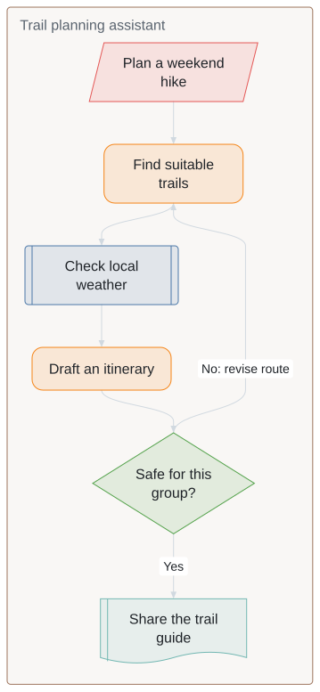

[Mermaid source](sources/agentflow.mmd) · [HTML example](index.html#agentflow)

```sh
beautiflow render examples/recipes/diagram-types/sources/agentflow.mmd --format svg --theme github-light --output examples/recipes/diagram-types/rendered/agentflow.svg
```

## Block diagram

### A greenhouse that responds to its surroundings

Three sensors feed one controller, which operates irrigation, shade, and ventilation. Blue reads the environment, green decides, and orange acts.

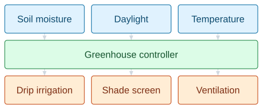

[Mermaid source](sources/block.mmd) · [HTML example](index.html#block)

```sh
beautiflow render examples/recipes/diagram-types/sources/block.mmd --format svg --theme github-light --output examples/recipes/diagram-types/rendered/block.svg
```

## C4

### The neighborhood library, in context

Members and librarians share a lending service, while book supply and message delivery stay outside its boundary.

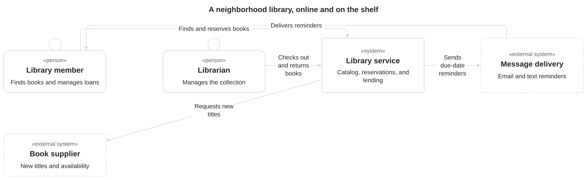

[Mermaid source](sources/c4.mmd) · [HTML example](index.html#c4)

```sh
beautiflow render examples/recipes/diagram-types/sources/c4.mmd --format svg --theme github-light --output examples/recipes/diagram-types/rendered/c4.svg
```

## Cynefin

### Which kind of festival problem is this?

A water refill needs a checklist; a storm needs immediate action. Different situations call for different ways of deciding.

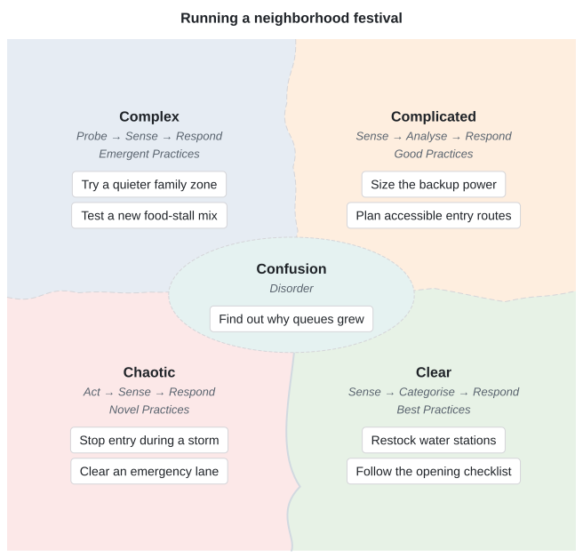

[Mermaid source](sources/cynefin.mmd) · [HTML example](index.html#cynefin)

```sh
beautiflow render examples/recipes/diagram-types/sources/cynefin.mmd --format svg --theme github-light --output examples/recipes/diagram-types/rendered/cynefin.svg
```

## Event modeling

### From a coffee order to a fresh roast

Follow one order through a blend picker, commands, recorded events, a roast queue, and a dispatch board.

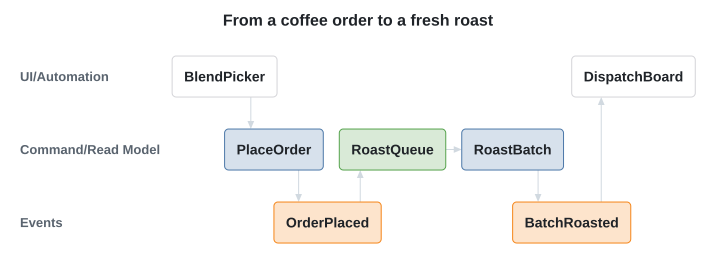

[Mermaid source](sources/eventmodeling.mmd) · [HTML example](index.html#eventmodeling)

```sh
beautiflow render examples/recipes/diagram-types/sources/eventmodeling.mmd --format svg --theme github-light --output examples/recipes/diagram-types/rendered/eventmodeling.svg
```

## Gantt

### Launch a neighborhood coffee club

Tastings, packaging, checkout, and roasting overlap on an authored June 2027 schedule, ending with the first shipment.

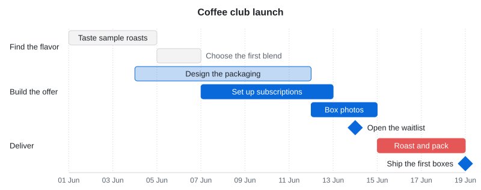

[Mermaid source](sources/gantt.mmd) · [HTML example](index.html#gantt)

```sh
beautiflow render examples/recipes/diagram-types/sources/gantt.mmd --format svg --theme github-light --output examples/recipes/diagram-types/rendered/gantt.svg
```

## Ishikawa

### Why did dinner arrive late?

Investigate possible causes across the kitchen, ordering, delivery, and staffing. These are hypotheses to check, not proven causes.

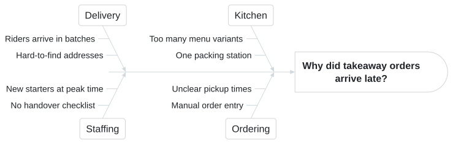

[Mermaid source](sources/ishikawa.mmd) · [HTML example](index.html#ishikawa)

```sh
beautiflow render examples/recipes/diagram-types/sources/ishikawa.mmd --format svg --theme github-light --output examples/recipes/diagram-types/rendered/ishikawa.svg
```

## User journey

### The highs and lows of a first overnight hike

The ridge view scores better than packing a heavy bag or drying wet gear. Shared tasks show where a guide can help.

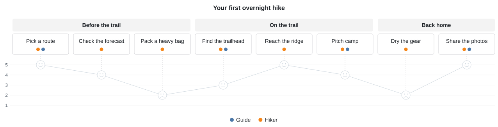

[Mermaid source](sources/journey.mmd) · [HTML example](index.html#journey)

```sh
beautiflow render examples/recipes/diagram-types/sources/journey.mmd --format svg --theme github-light --output examples/recipes/diagram-types/rendered/journey.svg
```

## Kanban

### Get a community garden ready for visitors

Herb spirals and shady benches start as ideas; irrigation is underway, while paths and plant labels are ready for visitors.

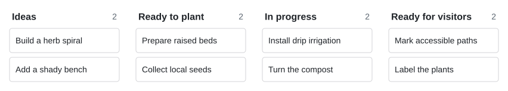

[Mermaid source](sources/kanban.mmd) · [HTML example](index.html#kanban)

```sh
beautiflow render examples/recipes/diagram-types/sources/kanban.mmd --format svg --theme github-light --output examples/recipes/diagram-types/rendered/kanban.svg
```

## Mindmap

### Make room for a weekend outside

A compact planning map connects places, a light packing list, leave-no-trace habits, and things worth recording.

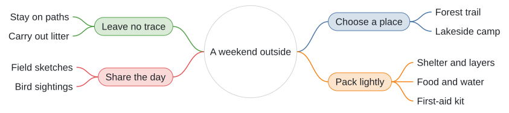

[Mermaid source](sources/mindmap.mmd) · [HTML example](index.html#mindmap)

```sh
beautiflow render examples/recipes/diagram-types/sources/mindmap.mmd --format svg --theme github-light --output examples/recipes/diagram-types/rendered/mindmap.svg
```

## Packet

### Inside a trail sensor message

An illustrative 192-bit telemetry format gives identification, timing, temperature, humidity, and error checking their own fields.

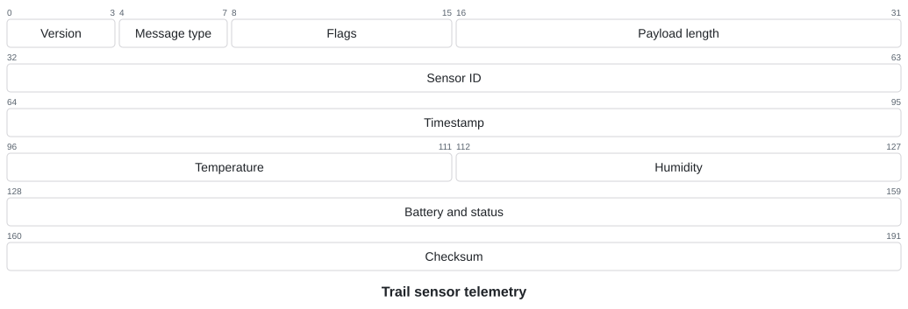

[Mermaid source](sources/packet.mmd) · [HTML example](index.html#packet)

```sh
beautiflow render examples/recipes/diagram-types/sources/packet.mmd --format svg --theme github-light --output examples/recipes/diagram-types/rendered/packet.svg
```

## Quadrant chart

### What should the library improve next?

Compare six proposals by effort and benefit. Clearer signs and text reminders sit apart from a custom app or a new reading room.

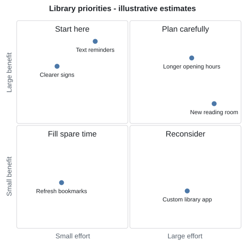

[Mermaid source](sources/quadrantChart.mmd) · [HTML example](index.html#quadrantChart)

```sh
beautiflow render examples/recipes/diagram-types/sources/quadrantChart.mmd --format svg --theme github-light --output examples/recipes/diagram-types/rendered/quadrantChart.svg
```

## Radar

### Choose a bike for the everyday ride

Compare a city bike, an e-bike, and a folding bike across comfort, cargo, hills, range, and upkeep. Scores illustrate trade-offs, not product test results.

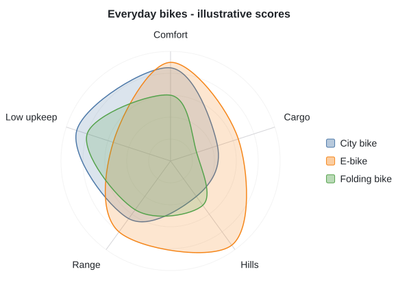

[Mermaid source](sources/radar.mmd) · [HTML example](index.html#radar)

```sh
beautiflow render examples/recipes/diagram-types/sources/radar.mmd --format svg --theme github-light --output examples/recipes/diagram-types/rendered/radar.svg
```

## Railroad

### A tiny field-guide search language

Build a query from habitat, season, or species terms, with optional negation, quoted values, and repeated AND clauses.

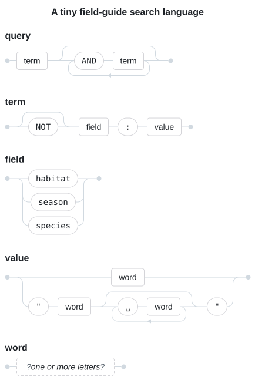

[Mermaid source](sources/railroad.mmd) · [HTML example](index.html#railroad)

```sh
beautiflow render examples/recipes/diagram-types/sources/railroad.mmd --format svg --theme github-light --output examples/recipes/diagram-types/rendered/railroad.svg
```

## Requirement

### What must a cargo bike prove?

Connect wet braking, night visibility, and carrying groceries to the tests or demonstrations that verify each requirement.

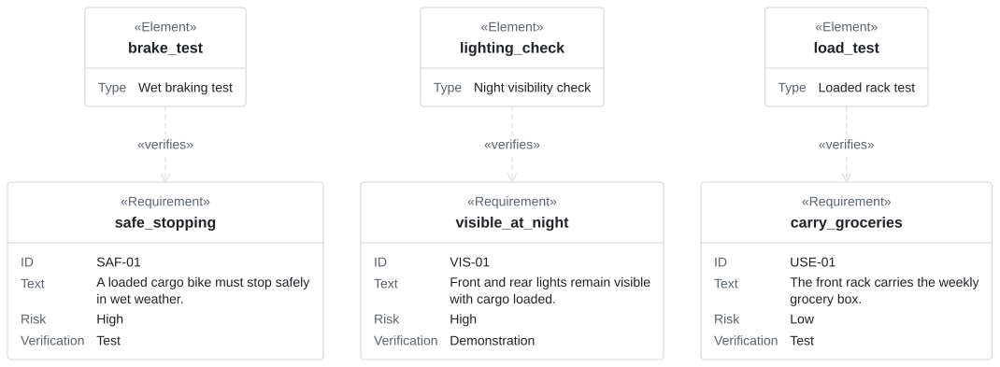

[Mermaid source](sources/requirement.mmd) · [HTML example](index.html#requirement)

```sh
beautiflow render examples/recipes/diagram-types/sources/requirement.mmd --format svg --theme github-light --output examples/recipes/diagram-types/rendered/requirement.svg
```

## Sankey

### Where a sunny day’s energy goes

Trace an illustrative 48 kWh through solar generation, grid import, battery storage, household uses, export, and storage losses. Every intermediate flow balances.

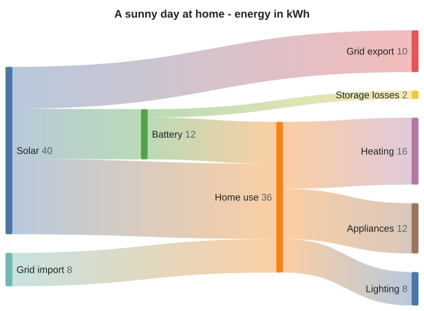

[Mermaid source](sources/sankey.mmd) · [HTML example](index.html#sankey)

```sh
beautiflow render examples/recipes/diagram-types/sources/sankey.mmd --format svg --theme github-light --output examples/recipes/diagram-types/rendered/sankey.svg
```

## Swimlane

### One repair café visit, three responsibilities

A visitor, welcome desk, and volunteer pass an item from registration through diagnosis, repair, and a final try-out.

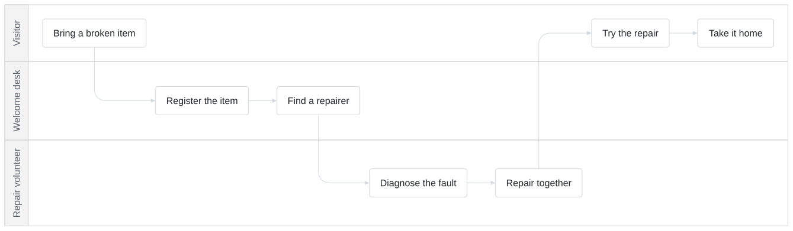

[Mermaid source](sources/swimlane.mmd) · [HTML example](index.html#swimlane)

```sh
beautiflow render examples/recipes/diagram-types/sources/swimlane.mmd --format svg --theme github-light --output examples/recipes/diagram-types/rendered/swimlane.svg
```

## Timeline

### A year under the stars

A fictional community observatory moves from scouting a dark-sky site to training guides, opening public nights, and sharing a sky atlas.

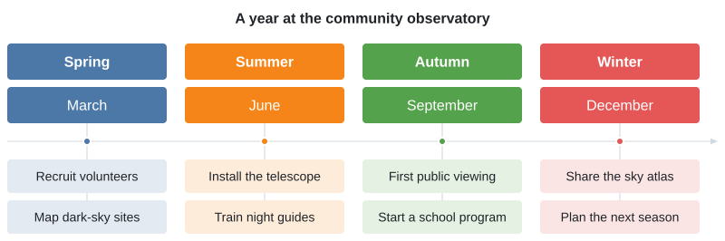

[Mermaid source](sources/timeline.mmd) · [HTML example](index.html#timeline)

```sh
beautiflow render examples/recipes/diagram-types/sources/timeline.mmd --format svg --theme github-light --output examples/recipes/diagram-types/rendered/timeline.svg
```

## Tree view

### Bring the field notes home

Bird recordings, trail tracks, and sketches live in a small, browsable trip archive alongside the plan and packing list.

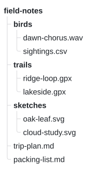

[Mermaid source](sources/treeView.mmd) · [HTML example](index.html#treeView)

```sh
beautiflow render examples/recipes/diagram-types/sources/treeView.mmd --format svg --theme github-light --output examples/recipes/diagram-types/rendered/treeView.svg
```

## Treemap

### Give a small game a launch budget

Allocate 100 illustrative budget units across making the game, reaching players, and keeping it running. Area makes the largest commitments visible.

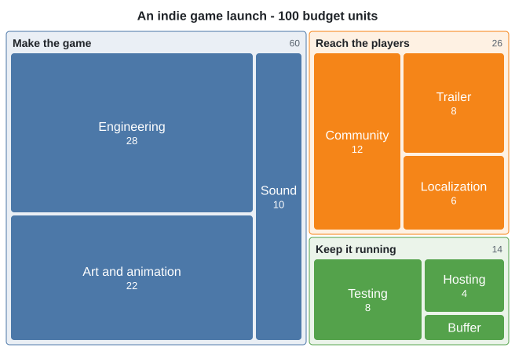

[Mermaid source](sources/treemap.mmd) · [HTML example](index.html#treemap)

```sh
beautiflow render examples/recipes/diagram-types/sources/treemap.mmd --format svg --theme github-light --output examples/recipes/diagram-types/rendered/treemap.svg
```

## Use case

### Who can do what at the library?

Members search, reserve, and renew; librarians handle borrowing and new titles. The system boundary keeps actors separate from capabilities.

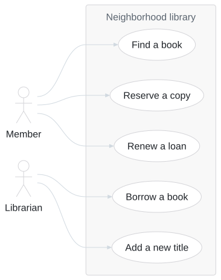

[Mermaid source](sources/usecase.mmd) · [HTML example](index.html#usecase)

```sh
beautiflow render examples/recipes/diagram-types/sources/usecase.mmd --format svg --theme github-light --output examples/recipes/diagram-types/rendered/usecase.svg
```

## Venn

### Who uses which parts of a wildlife garden?

An illustrative observation log compares visitors to flowers, water, and shelter. Intersections describe this fictional survey, not fixed species traits.

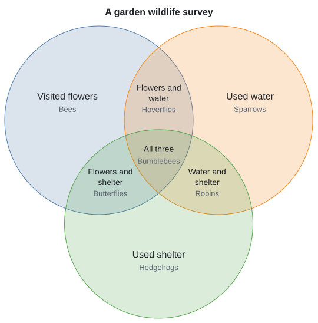

[Mermaid source](sources/venn.mmd) · [HTML example](index.html#venn)

```sh
beautiflow render examples/recipes/diagram-types/sources/venn.mmd --format svg --theme github-light --output examples/recipes/diagram-types/rendered/venn.svg
```

## Wardley map

### What sits behind a coffee subscription?

Start with a coffee lover’s need and follow dependencies into roast profiles, subscriptions, payments, and delivery. Positions are illustrative strategic judgments.

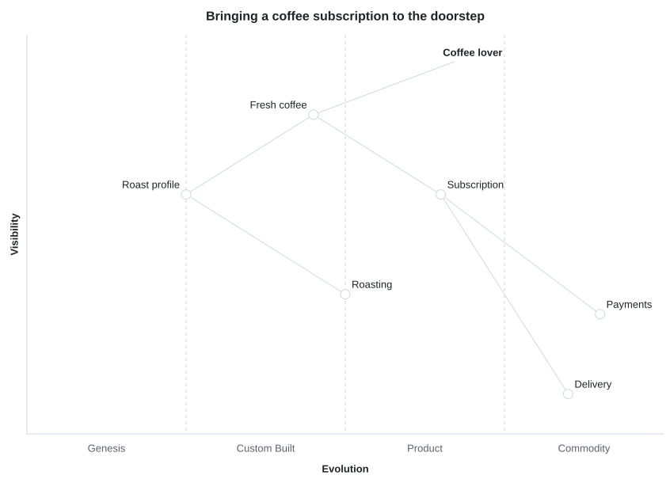

[Mermaid source](sources/wardley.mmd) · [HTML example](index.html#wardley)

```sh
beautiflow render examples/recipes/diagram-types/sources/wardley.mmd --format svg --theme github-light --output examples/recipes/diagram-types/rendered/wardley.svg
```
