# Weekly support requests

An XY chart compares an illustrative count across five weekdays. These numbers are fictional, not operational measurements.



[Mermaid source](source.mmd)

```bash
beautiflow render examples/recipes/xy-chart/source.mmd --format svg --theme github-light --output examples/recipes/xy-chart/rendered/chart.svg
```

XY charts support SVG/PNG, terminal output and read-only preview. They do not support geometry scores, transformations or automatic polish.
